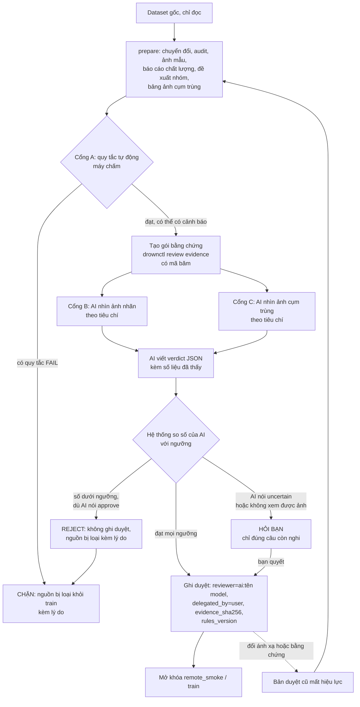

# Luồng duyệt dữ liệu có quy tắc (bạn không duyệt tay, và duyệt là TÙY CHỌN)

> **Duyệt không phải cổng chặn.** Theo quyết định của bạn (2026-10-26), chính sách hiện là `gating.mode: advisory`
> trong `configs/review_policy.yaml`: bạn **không cần duyệt** vẫn chạy `remote_smoke` và `train_candidate` bình thường.
> Bước duyệt chỉ để **xác nhận**: nếu bỏ qua, nguồn được ghi rõ là *chưa xác nhận* trong báo cáo và hồ sơ model, và ảnh chưa có nhóm
> được gom **tự động** bằng so khớp ảnh gần giống (vẫn chống rò rỉ khi chia tập). Đặt `mode: enforced` nếu muốn bắt buộc duyệt.
> Các sơ đồ và bảng dưới đây mô tả cách duyệt khi bạn (hoặc AI) chọn làm.

Mục tiêu: một nguồn dữ liệu chỉ được dùng để train khi nó đã qua các quy tắc cố định. **Máy chấm** những gì đo được bằng số.
**AI** (Claude hoặc AI khác) **nhìn ảnh** để trả lời những gì cần mắt nhìn, theo tiêu chí và ngưỡng ghi sẵn. Hệ thống tự quyết định
và ghi lại ai duyệt, dựa trên bằng chứng nào. Bạn chỉ bị hỏi khi AI trả `uncertain`.

Mọi ngưỡng nằm trong `configs/review_policy.yaml`. Đổi ngưỡng thì đổi `rules_version`, ghi trong mỗi bản duyệt.

## Sơ đồ



## Cổng A: quy tắc tự động (máy chấm)

| Quy tắc | Điều kiện | Nếu không đạt |
|---|---|---|
| `audit_valid` | không có vấn đề cấu trúc nào (khung, tham chiếu, ID) | chặn |
| `no_malformed_annotations` | không dòng nhãn nào hỏng (chuyển đổi dừng ngay nếu có) | chặn |
| `all_labels_resolved` | mọi tên nhãn gốc đã được ánh xạ, bỏ qua hoặc đánh dấu context | chặn |
| `same_box_conflict_fraction` | ≤ 0,1% khung trùng hệt nhưng khác nhãn | chặn |
| `min_boxes_per_mapped_label` | mỗi nhãn đã ánh xạ ≥ 100 khung | chặn |
| `min_class_share` | lớp ít nhất ≥ 2% tổng khung | cảnh báo |
| `tiny_box_fraction` | khung quá nhỏ ≤ 10% mỗi nhãn | cảnh báo |
| `ambiguous_label_names` | các tên dễ hiểu nhầm (`normal`, `person`, `standing`...) phải có `definition` ≥ 20 ký tự trong descriptor | chặn |
| `near_duplicate_checked` | ảnh đã được phân tích gần giống nhau | chặn |
| `largest_cluster_fraction` | cụm lớn nhất ≤ 10% số ảnh (nghi ngờ gom dây chuyền); > 25% thì chặn | cảnh báo / chặn |

## Cổng B: AI nhìn ảnh để duyệt ánh xạ nhãn

AI xem bảng ảnh **ngẫu nhiên** của từng nhãn (24 crop) và báo, cho **mỗi** nhãn:
- `samples_viewed` ≥ 24.
- `visible_person_fraction` ≥ 0,80: tỉ lệ crop thấy rõ một người (không phải vùng mờ hay texture).
- `label_consistent_fraction` ≥ 0,80: tỉ lệ crop khớp ý nghĩa nhãn chuẩn.
  - `drowning`: người có dấu hiệu đuối nước.
  - `swimming`: người hoạt động bình thường **trong nước** (bơi, đứng nước, đứng chỗ nông).
  - `out_of_water`: người ở ngoài nước.

## Cổng C: AI nhìn ảnh để duyệt nhóm (chống rò rỉ khi chia tập)

AI xem ba bảng ảnh, mỗi hàng là một cụm ảnh bị gom chung (viền màu = split gốc):
- Cụm **vắt qua nhiều split gốc**: báo `cross_split_pairs_viewed` ≥ 12 và `same_scene_fraction` ≥ 0,90 (hàng nào thật sự là cùng ảnh/cảnh).
- **Cụm lớn nhất**: `largest_cluster_same_scene_fraction` ≥ 0,80 (có phải một cảnh, hay nhiều ảnh không liên quan bị nối dây chuyền).
- Duyệt nhóm chỉ nói rằng ảnh gần giống nhau được giữ chung. **Không chứng minh** các nhóm đến từ video nguồn khác nhau, và báo cáo luôn ghi như vậy.

## Quyết định của hệ thống

| AI nói | Số liệu AI báo | Hệ thống ghi |
|---|---|---|
| approve | đạt mọi ngưỡng và quy tắc tự động đạt | **duyệt** (ghi `reviewer_kind: ai`) |
| approve | có ngưỡng không đạt, hoặc quy tắc tự động bị chặn | **từ chối**, lý do cụ thể |
| reject | bất kỳ | **từ chối** |
| uncertain | bất kỳ | **hỏi bạn**, không ghi gì |
| không xem được ảnh (`viewed_images: false`) | | **từ chối nhận verdict** |

Khi bị từ chối ở chế độ `enforced`, chính sách là `exclude_source`: nguồn đó bị loại khỏi train kèm lý do. Ở chế độ `advisory` kết quả từ chối vẫn được ghi và hiển thị như một cảnh báo, nhưng không chặn.

## Cách chạy

```powershell
cd D:\AI\DrowningProject
# 1. Tạo ảnh mẫu, báo cáo và bảng ảnh cụm trùng (trang Dữ liệu > Chuẩn bị, hoặc CLI)
.\.venv\Scripts\python -m drowning.cli review auto alanoud_swimming_drowning        # quy tắc tự động
.\.venv\Scripts\python -m drowning.cli review evidence alanoud_swimming_drowning    # gói bằng chứng cho AI
```
Lệnh `evidence` in ra thư mục bằng chứng, trong đó có:
- `README_AI_REVIEW.md`: hướng dẫn đầy đủ cho AI duyệt (luật, tiêu chí, ngưỡng, cách ghi kết quả).
- `auto-rules.json`, `quality.json`, `mapping-sheets/`, `group-sheets/`: đúng thứ AI cần xem.
- `verdict-template.json`: mẫu kết quả để AI điền.

Bạn đưa thư mục đó cho AI (nói: *"duyệt gói bằng chứng này theo README"*). AI xem ảnh, điền verdict rồi nộp:
```powershell
.\.venv\Scripts\python -m drowning.cli review submit alanoud_swimming_drowning verdict.json
```
Mã thoát `0` là xong, `3` là AI không chắc và cần hỏi bạn. Mỗi verdict và quyết định được lưu vĩnh viễn trong `reviews\verdicts\`.

## Ràng buộc để AI duyệt không thành "đóng dấu"
- Verdict gắn với **mã băm của gói bằng chứng** và **mã băm của ánh xạ**: đổi dữ liệu hoặc ánh xạ thì verdict cũ bị từ chối.
- AI phải xác nhận **đã nhìn ảnh**; không xem được thì chỉ được trả `uncertain`.
- Hệ thống **không tin lời "approve"**; nó tin các con số AI báo và so với ngưỡng.
- Duyệt của AI luôn ghi rõ `reviewer_kind: ai`, tên model, `delegated_by: user`, phiên bản chính sách.

## Giới hạn cần biết
- Các tỉ lệ do AI báo là **ước lượng theo mẫu**, không phải đo đạc đầy đủ. Mẫu ngẫu nhiên cố định theo seed nên lặp lại được, nhưng 24 crop mỗi nhãn chỉ cho thấy xu hướng.
- AI cũng có thể nhìn sai hoặc dễ dãi. Ngưỡng và quy tắc tự động là lớp bảo vệ, còn đánh giá cuối cùng vẫn nằm ở kết quả trên video thật của bạn (trang Đánh giá).
- Một AI duyệt chỉ nên coi là mức đảm bảo vừa phải: nếu dữ liệu quan trọng, hãy cho một AI thứ hai duyệt độc lập trên cùng gói bằng chứng và so kết quả.
